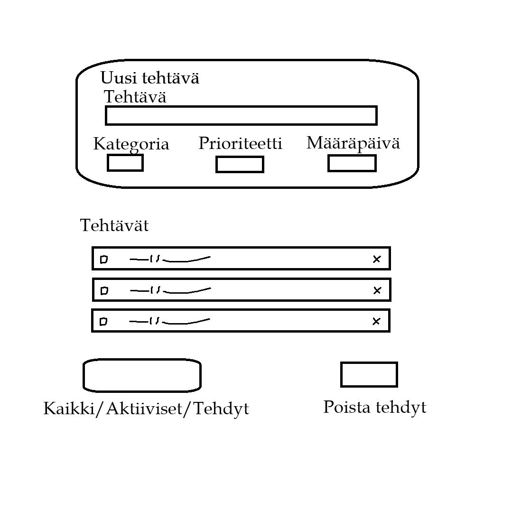
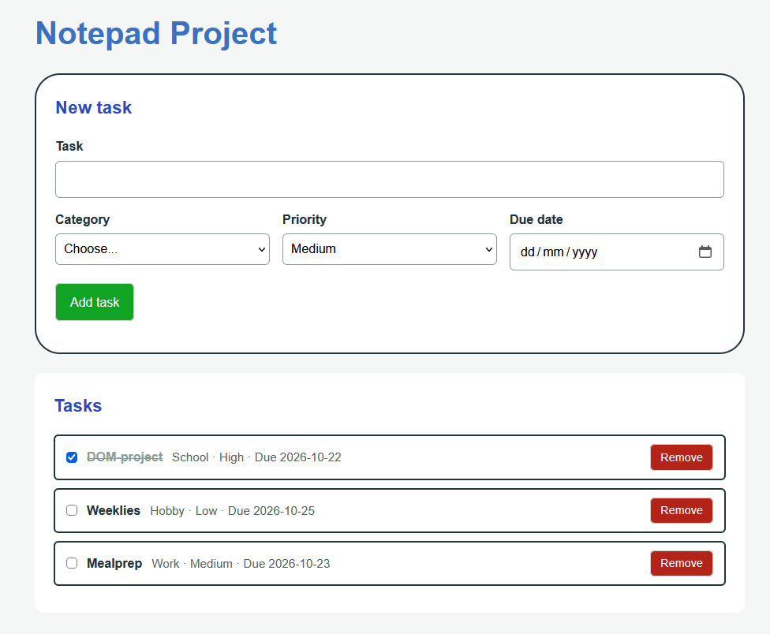

# To-Do Notepad List

**Author:** Rasmus Bergholm

## Project plan

### Project idea

This project is meant as a simple test to see how DOM manipulation works by using learned things from previous workshops.

### Planned features

- Button that adds a saved entry of a to-do thing 
- Different labels added to it
- Drag & drop with remove

### Wireframe / sketch

## Web links

- **Published application:** [Link here](https://rasmusdb.github.io/web-developer-2-project1//)
- **GitHub repository:** [Link here](https://github.com/RasmusDB/web-developer-2-project1)
- **Project video presentation:** [Link here](https://youtu.be/zhee11bN6Fw)

## About the application

**Notepad** is a web application that keeps track of your to-do lists with a couple of categories.

## Technologies

- HTML – page structure
- CSS – styling and layout
- JavaScript – functionality, DOM scripting and form validation
- localStorage – saving data in the browser

## How to use the application

1. Open the published application using the link above.
2. Fill in the form fields.
3. Drag and drop tasks, mark them as completed, remove entries.
4. Refresh the page and check whether data remains available in the browser.

## Running the application locally

1. Clone or download this repository to your computer.
2. Open the project folder.
3. Open `index.html` in a web browser.

## Screenshots

Add at least one screenshot of your working application.

Example:

## Known issues / limitations

**No known issues.**

## Self-assessment and learning reflection

- What did I succeed in? 
  - Using learned DOM-skills in a basic manner
- What was challenging? 
  - The drag and drop alongside using the array, also styling.
- What would I improve if I had more time? 
  - Styling and more functions, such as sorting.
- What did I learn about HTML, CSS, JavaScript and DOM scripting? 
  - It doesn't take much to make it work.
- What remained unclear or what would I like to learn more about? 
  - Different types of stylings and how to make it feel more responsive. 
- My self-assessed project grade: **8/10 points**

## Sources and acknowledgements

- Workshop 5 used for css styling.
- AI tool used: Claude
  - How the tool was used: Asking questions and to look over my project while I worked on it, had to rely on it a couple of times (marked in the .js and .css files) for things I didn't get right.

## License

This project is licensed under the MIT License.

More information about adding a license to a GitHub repository:  
https://docs.github.com/en/communities/setting-up-your-project-for-healthy-contributions/adding-a-license-to-a-repository